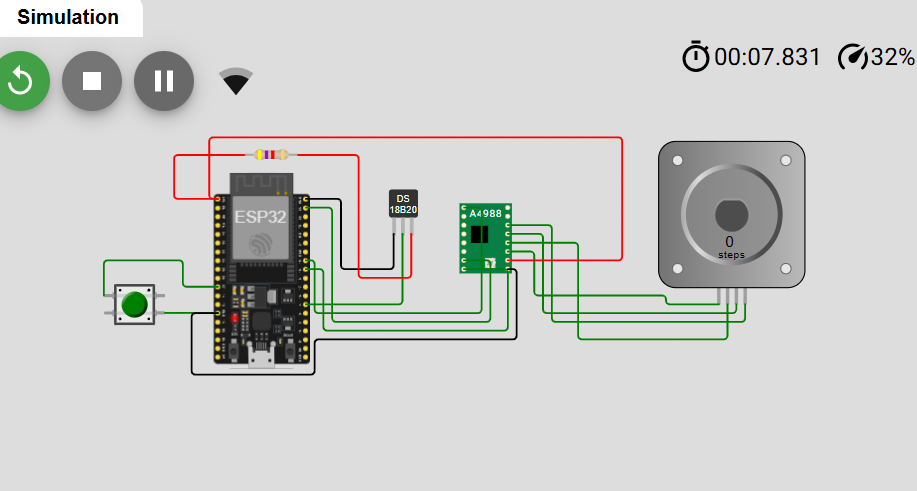
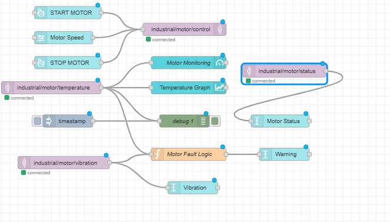
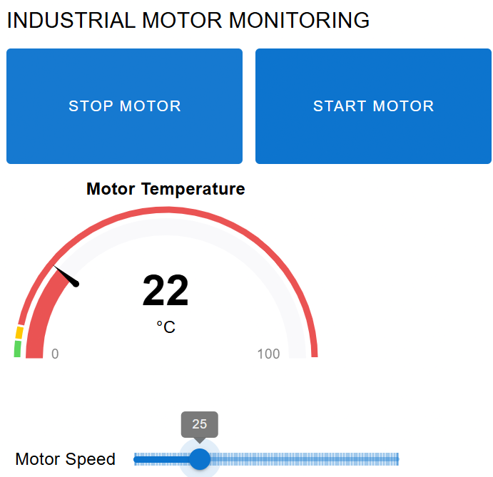

# IoT-Based-Industrial-Motor-Monitoring
Simulation-based industrial motor monitoring using ESP32, MQTT and Node-RED.
## Project Screenshots

### 1. Wokwi Circuit Diagram

### 2. Node-RED Software Flow

### 3. Industrial Motor Monitoring Dashboard

